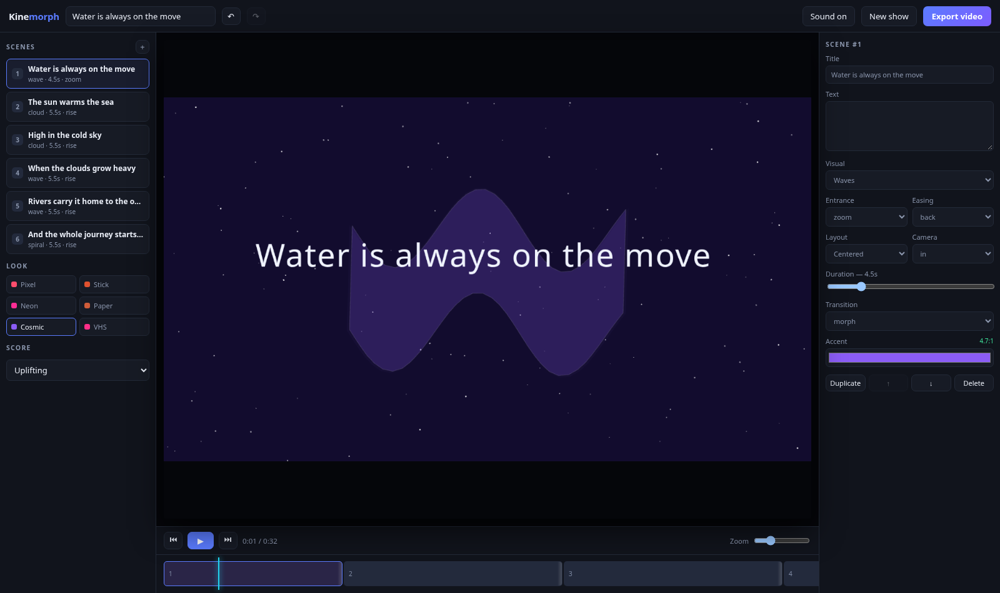

# Kinemorph

**The animation studio that exports real video.**

Kinemorph is the heavy sibling of [Kinemotif](https://github.com/drsamonline/kinemotif). Where
Kinemotif is one dependency-free HTML file that plays shows offline, Kinemorph is a proper
application: a React + TypeScript editor over a PixiJS WebGL renderer, a generative Tone.js
score, and frame-exact MP4 export through WebCodecs.

**[▶ Open the studio](https://drsamonline.github.io/kinemorph/studio/)** · **[Landing page](https://drsamonline.github.io/kinemorph/)**



---

## Quick start

```bash
npm install
npm run dev        # http://localhost:5173
npm run build      # writes studio/ (committed, served by Pages)
npm run typecheck
```

Node 20+. No other tooling.

---

## Architecture

Five packages, one editor. The dependency arrow only ever points one way.

```
apps/studio ──▶ @kinemorph/renderer ──▶ @kinemorph/core
     │                │
     ├───────────────▶@kinemorph/audio
     └───────────────▶@kinemorph/export
```

| Package | Responsibility |
|---|---|
| **@kinemorph/core** | Zod-validated project model, Zustand store, serialisable commands with undo/redo, story engine, timeline resolver, motif geometry, colour math. No DOM, no Pixi, no Tone. |
| **@kinemorph/renderer** | PixiJS compositor with motifs and seven diagrams. `render(project, time)` draws one frame. Handles styles, camera, entrances and transitions. |
| **@kinemorph/audio** | Score generator. `buildScore(mood, seconds)` returns note events; Tone.js plays them live, an `OfflineAudioContext` renders them for export. |
| **@kinemorph/export** | Mediabunny for encoding and muxing (it succeeded `mp4-muxer`): MP4/H.264 or WebM/VP9, plus 16-bit WAV audio stems. A real-time `MediaRecorder` path remains for browsers without WebCodecs. |
| **@kinemorph/studio** | The Vite + React editor. |

### Three decisions that matter

**The renderer is a pure function of (project, time).** Nothing advances its own clock. The
preview loop, the scrubber and the export all call `renderer.render(project, t)`. That is why
the exported video is exactly what you saw, and why a dropped frame is impossible: export
never records in real time.

**The renderer renders at the style's native resolution.** The stage is always 1920×1080
design units, but the backing store is 480×270 for Pixel Arcade and 1920×1080 for the clean
styles. Pixel styles are genuinely low-resolution rather than filtered to look that way, and
cheap styles are cheap to draw.

**Every mutation is a command.** `dispatch({ type: 'scene.update', id, patch })` runs through a
Zod schema, applies to an immutable project and pushes the previous one onto a history stack.
Undo, redo and — later — collaboration all fall out of the same structure.

### Determinism notes

- Randomness in the story engine comes from seeded generators, never `Math.random()`.
- The score is generated from `(mood, duration, seed)` into a note list before any audio node
  exists, so live playback and the export mixdown cannot drift apart.
- Export renders each frame with an explicit timestamp; there is no wall clock involved.

---

## Performance notes

- Motif geometry is cached per `(motif, pointCount)` — the morph path does not rebuild polygons.
- Scene views are cached per scene id and rebuilt only when the style changes (text metrics
  change with the fonts).
- The export loop keeps the encoder queue shallow (`encodeQueueSize > 6` → yield) so memory
  stays flat on long shows.
- The preview loop is driven by `requestAnimationFrame` in `App`, and React is not re-rendered
  per frame: the playhead and time label are updated imperatively through refs.

---

## Output formats

The renderer's design space follows the format, so portrait is a reflow and not a crop: the title
moves to the upper third and the artwork to the lower half, and split layouts become centred.

| Aspect | Output (720p preset) | Use |
|---|---|---|
| `16:9` | 1280 × 720 | Landscape, default |
| `9:16` | 720 × 1280 | Reels, Shorts, Stories, TikTok |
| `1:1` | 1280 × 1280 | Feed square |
| `4:5` | 1080 × 1350 | Instagram portrait |

The format lives on the project and is chosen in the top bar — the stage reflows immediately, and
the export uses it unless you override it in the export dialog.

## Export formats

| Output | Video | Audio | Use it when |
|---|---|---|---|
| **MP4** | H.264 | AAC if the browser has an AAC encoder, otherwise Opus | Sharing, uploading, anything that wants the most compatible file |
| **WebM** | VP9 | Opus | Smaller files, or when H.264 is unavailable |
| **WAV** | — | 16-bit PCM at the score's sample rate | Getting the soundtrack into a desktop editor. Some NLEs ignore Opus inside MP4; WAV is never ignored |

The export dialog picks the format, and **Download WAV** renders the score on its own — no video
render, so it takes a second.

```bash
npm run verify:export                        # MP4 + WAV, inspects the bytes
node tools/verify-export.mjs --container=webm
node tools/verify-export.mjs --aspect=9:16   # also decodes the result and reports its size
```

`tools/verify-export.mjs` drives the real dialog in a headless browser, then checks each file's
magic bytes. It is the only test that exercises export end to end, and it is deliberately not in
CI: a two-second show takes about a minute on a software renderer.

## Testing

```bash
npm test                 # Playwright against the built studio
npm run test:update      # regenerate the golden signatures after a visual change
```

| Suite | What it proves |
|---|---|
| `tests/selftest.spec.ts` | The 19 pure-engine assertions in `studio/selftest.html` pass in the built bundle, with no page errors. |
| `tests/signatures.spec.ts` | All **84** style × motif combinations render. Each frame is reduced to an 8×5 colour signature (mean RGB + non-blank ratio) and compared against `tests/signatures.json`. Tolerance is 16 per channel, so anti-aliasing and driver differences pass while a blank frame, a thrown exception or a palette drift fails. |
| `tests/studio.spec.ts` | The editor boots, the wizard generates a show, styles resize the canvas, editing renames a scene and `Ctrl+Z` undoes it. |

`studio/harness.html` is the render harness the golden test drives. It renders with
`preserveDrawingBuffer` so the frame can be read back — a harness-only cost, not a production one.

Playwright runs the *built* site through `vite preview`, so the tests exercise exactly what ships.
Locally, `CHROME_PATH=/usr/bin/chromium npm test` skips the browser download.

The golden frames render **without text**, so installed fonts cannot move them — the suite
covers artwork, and typography is covered by the editor smoke test.

Baselines must come from the same Chromium that verifies them. Regenerate on the runner, not on
your laptop:

```
gh workflow run ci.yml -f update_signatures=true   # uploads tests/signatures.json
gh run download <run-id> -n signatures -D /tmp/sig
cp /tmp/sig/signatures.json tests/signatures.json
```

This is not ceremony. The first baseline was generated on a different Chromium build and the
neon style drifted by 200 on one cell — the text block, because the two machines had different
fonts. Generating baselines where they are checked removes that whole class of false failure.

## Known limitations

- **MP4 audio is AAC where available, Opus otherwise.** Chrome has no AAC encoder, so it gets
  Opus; Safari and Edge get AAC. Opus-in-MP4 plays in browsers and VLC, but some desktop editors
  ignore it. The export dialog tells you which one you got. See the
  [guide](docs/guide.md#about-the-audio-codec).
- **Rendering is still on the main thread.** Encoding and muxing run in a worker (frames cross as
  transferable `ImageBitmap`s), but the WebGL render for each frame happens on the main thread.

  Moving the renderer into a worker is possible — PixiJS ships `environment-webworker/WebWorkerAdapter`
  — and it was investigated rather than assumed. Measured on this project's CI-class machine
  (ANGLE + **SwiftShader**, i.e. software rendering), a 60-frame 720p export takes 52.8s, which is
  ~880ms per frame with a 1034ms worst main-thread gap. That number is a property of software
  rendering, not of the architecture: the same frame on a GPU is single-digit milliseconds, where
  a 10ms freeze per frame is not worth a second rendering path that has to stay in sync with the
  84 golden frames.

  A cheaper fix was tried and **reverted on evidence**: yielding to the event loop between frames
  made the same export take 60.5s with a 1509ms worst gap, because a software renderer has no
  spare CPU to paint with. Re-run the measurement on a GPU machine before deciding.
- **Collaboration is not implemented.** The command layer is designed for it, but there is no
  transport.
- **Glitch transition is an approximation**, not a slice-based tear.

---

## Repository conventions

Same house rules as the rest of the fleet:

| File | Purpose |
|---|---|
| `PAGES.json` | Declares every published page and its source file. |
| `tools/check-links.mjs` | Fails if a local reference is broken or the build is missing. |
| `.github/workflows/ci.yml` | `npm ci` → typecheck → build → link check → verifies the committed build matches the sources. |
| `studio/` | Build output, committed on purpose so Pages can serve it from the branch. |
| `MANIFEST.json` | Inventory of every tracked file with a SHA-256 and a class (`source`, `generated`, `asset`, `tooling`, `hand`). `tools/manifest.mjs --check` fails on unlisted or missing files. |
| `.github/dependabot.yml` | Weekly, one grouped PR per ecosystem; majors are ignored on purpose. |
| `SECURITY.md` · `PRIVACY.md` · `CODE_OF_CONDUCT.md` · `CITATION.cff` | The same set every repo in the fleet carries. |

---

## Licence

MIT — see [LICENSE](LICENSE).

Built on PixiJS, GSAP, Tone.js, Zustand, Zod and mp4-muxer. Prior art that shaped the design:
GSAP's timeline model, Theatre.js's sequencing ideas, anime.js's SVG morphing, and the
WebCodecs export recipes now common in browser video tooling.
